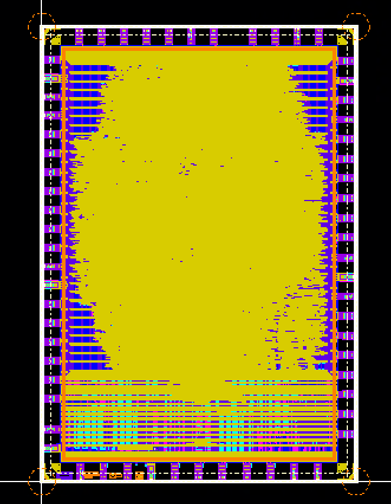

# Getting Started

> This section of the project puts a large amount of stress on the servers. You MUST start early to avoid having your work interrupted if the servers go down.

## What is Physical Design?

Physical design is the process of turning the RTL made by the Digital Design and Digital Verification teams into an actual chip layout we can send to a foundry.

Physical design is very important to the tapeout process, and it's where a lot of the decisions that affect the performance of the final chip are made. It is a physical designer's job to take the somewhat abstract RTL created by digital designers and optimize it into a physical chip under the real-world constraints of power, timing, and area.



*The final layout of our Tapeout 1 design, containing over 3 million transistors!*

## About the Project
The Physical Design (PD) subteam onboarding project is intended to guide you through fundamental scripting techniques and their use within the physical design process. 

The project involves completing the tasks in this README. The assignment includes the following tasks:
- Synthesis
- Floorplanning
- Timing Analysis
- Clock Gating
- Cell Swapping
- Signoff

Physical Design is a broad discipline that involves a wide array of skills. If you haven't had any experience with VLSI in the past, don't expect to skim the assignment in this README and finish it in an hour — you will have to research, ask questions, and _learn_ to complete the project.

We try to offer as many resources as we can to guide you through this project. We've linked plenty of resources for you to get started with new topics within the assignment, there are guides in `docs/` to answer frequently asked questions, and we're always happy to answer questions posted in the Discord.

### Tools You'll Use

<details>
<summary><b>Synopsys Design Compiler</b></summary>
Design Compiler is the first tool we use in the design process. It takes RTL files and synthesizes them into netlists.
<br><br>
<blockquote>
<b>What's a netlist?</b>
<br>
A netlist is a list of all the logic gates used in a design and how they're connected. The netlist generated by synthesis doesn't specify where each gate is or how far apart they are; just that the connections exist. That information isn't added until after Place and Route.

Netlists are used to generate the actual chip layout and perform STA.
</blockquote> 

<blockquote> 
<b> ... What's STA? </b>
<br>
STA stands for Static Timing Analysis. In STA, we use the worst-case propagation delays of each gate to make an educated guess about how long data takes to go from input to output in each part of our circuit. This lets us estimate how fast we can clock our design — the period of our cycle has to be <i>longer</i> than the time it takes for a signal to propagate through our longest path.
</blockquote>

A lot of the synthesis process is automated by Genus's algorithms, but designers can influence the final netlist by setting Power, Timing, and Area constraints to influence how Genus optimizes the design. This comes with tradeoffs, though — the tighter the constraints, the longer synthesis takes to run. If the constraints are too tight, it may even fail.

You won't have to directly interact with Genus during this assignment, but it will be used in the background by our flowtool.
</details>


<details>
<summary><b>Cadence Innovus</b></summary>
<p>
After we generate a netlist with Design Compiler, we want to figure out where each logic gate goes. This stage is called Place and Route (PnR).

Innovus takes the pre-layout netlist and performs the following processes on it:

<ul>
    <li><b>Floorplanning:</b> Create an initial floorplan to determine the overall size and aspect ratio of the chip and place major logic blocks and I/O pads.</li>
    <li><b>Placement:</b> Place standard cells (logic gates specified by our design library) and optimize their placement for timing, area, and congestion. </li>
    <li><b>Clock Tree Synthesis (CTS):</b> Distribute a clock signal across the design. It takes time to propagate signals, so Innovus needs to carefully optimize the clock layout to make sure the clock signal doesn't get to any part of the design too early or too late.  </li>
    <li><b>Routing:</b> Place connections between standard cells, assign metal layers, and insert vias to connect them.  </li>
    <li><b>Optimization:</b> Now that the overall layout is almost done, Innovus goes back and optimizes decisions made in all the previous steps.</li>
    <li><b>Signoff:</b>  The cell library used in a chip enforces a set of rules that dictate how small cells can be, how close together they can be packed, and other restrictions. Innovus tries to follow these rules during the entire process, but sometimes errors may be looked over or unavoidable. This step generates a Design Rule Checking (DRC) report that lets us know potential problems without design.   </li>
    <li><b>Output:</b> Outputs a GDSII file. This is the file that specifies the final layout of our chip. This is what we send to the foundry!</li>
</ul>
During the entire process, Innovus optimizes Power, Timing, and Area more or less agressively depending on the design constraints specified by the physical designer. This is a tradeoff between performance and PnR runtime.
</p>
</details>


<details>
<summary><b>FastX or MobaXterm</b></summary>
<p>
Innovus runs on the Linlab servers. Since it has a GUI, you'll need a terminal emulator with X11 forwarding enabled to be able to use it.

We recommend FastX or MobaXterm, but any remote terminal with GUI support should work.
</p>
</details>

<details>
<summary><b>TCL</b></summary>
<p>
TCL is pronounced "Tickle." 

It stands for Tool Command Language. It's a scripting language used in electronic design automation (EDA). We use it because, while optimizing a chip, we will run the "flow" (the process of turing RTL into a design file) many times. This flow involves running a whole bunch of commands in our CLI, and doing this over and over can get exhausting.

Instead of typing all these commands manually, we can use TCL to create scripts that will run the flow for us!

Many TCL scripts that make running our flow easier already exist, so while it's not explicitly required to learn TCL, learning about it helps to understand what's happening when you run the flow.

Here's a simple TCL file, `greeting.tcl`, as an example:


```bash
set name "John"
set greeting "Hello, $name!"
puts $greeting
```

To run it, we run `tclsh greeting.tcl`:

```bash
[user@host] tclsh greeting.tcl
Hello, John!
```

To learn more about TCL, see [this resource](https://www.tcl.tk/man/tcl8.5/tutorial/tcltutorial.html).

[Here is a tutorial](https://www.tutorialspoint.com/tcl-tk/tcl_environment.htm) on how you could set up an environment and play around with TCL by writing simple scripts.
</p>
</details>

<details>
<summary><b>Python</b></summary>
<p>
You'll need to know some basic Python File I/O and String processing in order to parse the timing report file we've provided you.

[This guide on File I/O](https://www.tutorialspoint.com/python/python_files_io.htm) and [this guide on String processing](https://www.pythoncentral.io/how-to-parse-a-string-in-python-a-step-by-step-guide/) might be good places to start if you don't have any Python experience.

You might also need to understand some (very) basic Python data structures to store the information you extract from the file.
</p>
</details>

## Resources
- Read the `docs/`!
    - [Running the Flowtool](./docs/Running-the-Flowtool.md)
    - [Using Innovus](./docs/Using-Innovus.md)
    - [Virtuoso Signoff Checks (DRC and LVS)](./docs/Virtuoso-Signoff-Checks.md)
- [Setup and Hold Times](https://nandland.com/lesson-12-setup-and-hold-time/)
- [Static Timing Analysis](https://anysilicon.com/the-ultimate-guide-to-static-timing-analysis-sta/)
- [STA (Advanced)](https://www.eng.biu.ac.il/temanad/files/2018/12/Lecture-5-STA.pdf)
- [Python File I/O](https://www.tutorialspoint.com/python/python_files_io.htm)
- [Python String Processing](https://www.pythoncentral.io/how-to-parse-a-string-in-python-a-step-by-step-guide/)
- [VLSI Concepts](https://www.vlsi-expert.com)
- [VLSI Acedemy Youtube](https://www.youtube.com/watch?v=kQYav5eZGeY&list=PL1h5a0eaDD3pimcMlzW15RpW02HPzIziL)
- The [Cadence Support](https://www.support.cadence.com) website
- The SiliconJackets Discord
- Contact a team lead:

| Name | Discord | Email |
| --- | --- | --- |
| Patricio Cortez | lovebaron | pcortez3\@gatech.edu |
| Jiho Jun | Dj0812 | jjun49\@gatech.edu |
| Jaevy Wangsiriwech | riwecj | jwangsiriwech3\@gatech.edu | 
| Cooper Shaw | cooper.shaw | shaw\@gatech.edu |

> Please use `#onboarding-help` for general questions. Reserve directly contacting a lead for questions that cannot be posted publicly.

# Assignment

Follow along with the instructions and answer all questions. Write your answers in the submission template `submission.pptx`. There will be a slide available that will correspond to a part of the onboarding. You will submit this file as a pdf.

> Please do not add or remove slides. The goal is to check your submission against our key, and it will be easier to do so side-by-side.

## Introduction to Physical Design
In this section, you will follow a Vulkos training course that introduces the basics of the physical design process.

To get started, complete the **[Introduction to ASIC Design](https://www.vulkos.co.uk/login?redirect=%2Flearn%2Fintro-to-asic-design)** course on Vulkos. The course consists of four parts and should not take too long to complete.

## Part 1: Synthesis
In the previous Digital Design and Design Verification onboarding projects, you developed and verified the RTL for your design. We will now use that RTL as the starting point for the Physical Design flow. 
 
The first step of the flow is synthesis, where the RTL description of your design is mapped into a gate-level implementation using cells from the our standard cell library, Cadence Sky130. In this section, you will add your RTL and make sure it synthesizes successfully.

### 1.1: Synthesis Setup
You will need to copy the contents of your `digital-design-onboarding-F26/src/verilog/` to `inputs/rtl/src/verilog/`. Additionally, in `sram_wrapper.sv`, you will need to change the SRAM instantiation. You will need to change `CF_SRAM_1024x32_macro` to `CF_SRAM_1024x32` when instantiating the SRAM. This will allow our tool to recognize the SRAM as a blackbox rather than a synthesizable module. More details on that later.

You will need to specify the top-level design name in `scripts/config.tcl` by replacing `DESIGN` with your top level RTL module name.

Once you've done that, you can run `SJapr syn` to run the synthesis flow to completion. It should synthesize. If you get synthesis errors from your RTL, it will be up to you to fix them before you continue. After the synthesis run completes, you should see outputs in your `outputs/synthesis` directory. These will have the output files of your most recent synthesis run.

**1.1a:** Under `outputs/synthesis`, there should be a file that reports the area your design uses. This includes the number of instances and total cell area of your design. Find this information and include it in your submission doc under the heading 1.1a.

**1.1b:** In the same subdirectory, you will find a file named `<DESIGN>.gate.v`. What is this file? What is its purpose?

## Part 2: Floorplanning
Floorplanning establishes the size and shape of the core and determines where large physical components, such as SRAM macros, will be placed. Decisions made during floorplanning can strongly affect placement, routing, timing, and power delivery later in the flow. 

For this section, you will find and add several commands used to correctly floorplan the design. You will use information from synthesis to create the floorplan, place the SRAM macros, and construct the power plan.

The following parts will have you edit `step_floorplan.tcl`.

### 2.1: Determining the Core Area
To place cells, we first need to determine how much silicon area we want to place them in. To do this, we need information on the cell area and other characteristics of the design. The statistics you found in Part 1.1a will be useful for determining the core area, so make sure you do that first!

**2.1a: Determine the Core Area** 

We are targeting a core utilization of ~50% at floorplan. This means that the area of our cells will take up approximately 50% of the floorplan. Two of our cells, the SRAMs, are larger than usual and need special handling when doing area calculation.

The dimensions of each SRAM are 387.870 by 306.775 microns. There is also a halo of 21 microns that extends on each side of the SRAM. A halo is a region that restricts cell placement. This essentially means that there is some space used in the floorplan that is not represented in cell area statistics, so we will need to account for that in our calculation.

There are some other considerations, but we'll work with this for now. Use your results from part 1.1a along with the information above to calculate the core floorplan size that will result in ~50% utilization. Use an aspect ratio of 2:1. Don't take each number from your results at face value. One area could be a subset of another area. Note the size of this for later. Briefly show your work.

### 2.2: Making the Floorplan
Right after defining the core offsets is where we'll place our floorplan command. This will determine the available area allocated for cell placement.

We will then need to place the macros by abutting them side-to-side.

**2.2a: Initialize the Floorplan**

Find the section in `step_floorplan.tcl` that generates the floorplan and specify the appropriate parameters. Paste the command into your doc.

**2.2b: Place the macros**

Depending on your RTL, your macros may be named differently or part of a different hierarchy. Retrieve the name of the SRAMs and find a command to place them right after defining the design node:
* The macros should be abutted side-to-side (i.e. touching borders)
* The macros should be fixed after placement. In other words, they should not be moved at all in subsequent steps.
* Use common sense. Don't place the macros outside the core area or in a spot that will cause trouble for the tool (and by extension you). Try to place them in the center if you can.

Paste the command into your doc after you're done.

### 2.3: Defining a Power Ring for a Group
For many reasons, defining a power ring around macros improves power integrity of the design. This exercise will have you define a power ring around a group of macros.

**2.3a:** Do some research on power rings and power grids. Briefly, what are some of the benefits of placing a power ring around macros?

**2.3b: Make and Select a Group**

To do this elegantly, we will need to do two things: Make a group for the SRAMs, which will tell Innovus to select the macros, and then place the rings.

The commands to define and select a group are shown below:
```
createInstGroup group_SRAMs
addInstToInstGroup group_SRAMs <Your SRAM inst 1>
addInstToInstGroup group_SRAMs <Your SRAM inst 2>
selectObjByProp Instance <group>=<group_SRAMs>
```

No deliverable necessary here.

**2.3c: Add the Power Ring**

Right after the commands to make and select a group, you will add the power ring. The command to add a power ring is provided to you. 

Fill out the call to the `addRing` command in `step_floorplan.tcl`, taking into account the following parameters:

* It must be defined around a cluster
* The jog distance will be 0.4 microns
* The power nets are VDD and VSS
* The rings are of type `block_rings`
* Use `met4` and `met5` as the routing layers for the ring itself
* The width and spacing are 6.2 and 3.2 microns, respectively
* The offset is 5 microns

> Refer to Cadence Innovus documentation, or run `man addRing` from the Innovus shell to learn about flags you can pass to the addRing command.

Paste the ring command into your doc.

### 2.4: Reporting Utilization
Before you run the flow to completion, we will briefly find a command to report utilization after placement.

**2.4a: Reporting Utilization**

Find a command that reports utilization in legacy Innovus using the methodspreviously described for finding Innovus commands. Its output should look something like this:

```
Checking Preroutes.....
No. of regular pre-routes not on tracks : 0 

Reporting Utilizations.....

Core utilization  = 100.097872
TU for group group_SRAMs = 100.000000
Effective Utilizations
Average macro density = 0.000.
Average module density = 1.000.
Pure std cell Density 1.000000
 Density for the design = 1.000.
       = stdcell_area 998795 sites (1902105 um^2) / alloc_area 998795 sites (1902105 um^2).
Pin Density = 0.02417.
            = total # of pins 27846 / total area 1152220.
```

Paste the command at the end of `step_place_std_cells.tcl` and make sure to dump the output in a file called `util.txt`.

Include the name of the command and its output in your submission.

> You may find interactive mode particularly useful for this step.

### Run the Flow to Completion
Once you've done Parts 1 & 2, you should be able to run the flow to completion. Either restart innovus and run `SJapr apr` or `sj_run_remaining` if you're currently in interactive mode. The runtime of the flow will depend on server traffic and luck. Once it's done, you should get a completely routed design!!

## Part 3: Timing Analysis
Completing the physical design flow does not necessarily mean that the design meets its timing requirements. After placement, clock tree synthesis, and routing, we use Static Timing Analysis (STA) to determine whether signals can propagate through the implemented design within the required clock period.

Two useful timing metrics are: 

- Worst Negative Slack (WNS): the slack of the single worst timing path in the design. 

- Total Negative Slack (TNS): the sum of the negative slack across all violating timing paths. 

A negative slack indicates that a timing requirement is not being met. In this section, you will analyze the timing of your current implementation before making any optimizations. Additionally, in this section, we will solely focus on setup timing. Hold timing is equally (if not more important) to close, but closing setup timing is far more interesting for beginners, so we'll focus on that for now.

### 3.1: Reporting Timing
Open your routed design if it's not already opened. In this section, we'll take a look at some timing paths and understand the slack calculation.

Use the command `report_timing` to get the worst performing path in the design. Unless you're an incredible architect, the path should fail.

**3.1a: Gathering Basic Information from a Report**

Record the following values from the report:
* Startpoint
* Endpoint
* Path Delay
* Slack

Make inferences on why the path does so poorly. Is there a cell with a higher delay than others? Is the logic depth too high? You might want to compare this path with paths that pass timing. A quick way to see this is by adjusting the `max_paths` parameter in the `report_timing` command. Make sure to support your answer as to why this path does poorly.

### 3.2: Calculating TNS
This is not the only path that fails timing. There are likely many more. The goal of this exercise to to write a proc that calculates the TNS of the design. To do this, we will use the `get_db` command.

The command `get_db` is an extremely powerful command that gives you information about anything in the design. For example, the command 
 
`get_db insts`
 
Returns a list of every instance in the design. As you can imagine, it’s going to be a very long list.  
Some arguments also have attributes. For example, if I want a list of the pins of every instance, we can write 
 
`get_db insts .pins `
 
If I want to know the library cell of some instances, we can write 
 
`get_db insts .lib_cell`

Just like with instances, we can obtain similar information from a timing report. To do this, we can simply pass the `-collection` flag in `report_timing` and saving that information in a TCL variable:

```
set path [report_timing -collection -max_paths 1]
get_db $path .*
```
> Note: Specifying `*` after `.` will dump every attribute of the timing path

**3.2a:** Write a TCL proc that returns the TNS of the design. Save this proc in `scripts/helpers`. The proc should be short, so paste it into your submission doc.

**3.2b:** Save the WNS and TNS. You will use these for comparison later.

## Part 4: Clock Gating
Clock gating is a concept that will show up time and time again in your studies and interviews. We may as well introduce it to you now!

Read up on clock gating [here](https://anysilicon.com/the-ultimate-guide-to-clock-gating/). You do not need to know everything right now, but it will help with some parts later.

### 4.1: Enabling Clock Gating
There is one command that needs to be modified to enable clock gating. It will start all the way back to synthesis since we will need to regenerate the netlist.

**4.1a:** Scour the Synopsys docs to find the correct command and flag to pass in. Rerun the synthesis flow once you do this. Note down the change you made.

> Warning: This has nothing to do with `step_clock_gate.tcl`. Our implementation is different. It will literally consist of passing in a single flag.

If done correctly, there will now be clock gate instances in the design.

### 4.2: PDKs and Netlists, for Beginners
We will spend some time proving there are clock gates in the design. As *student* physical designers, a lot of what we find we must find ourselves. We spend a considerable amount of time equipping ourselves with the knowledge of how to find information about something that isn't given to us.

In this case, we do not know how to locate where the clock gates were instantiated, if at all. We do not even know what the instances are called. To figure this out, we will have you check the netlist and the PDK.

Part of the PDK includes our liberty file, which defines timing information for the cells that we use in our design. One such library is located at 

```
resources/cadence_sky130/sky130_scl_9T_0.1.2/sky130_scl_9T/lib/sky130_sky130_tt_1.8_25_nldm.lib
```

**4.2a:** Open this file and find the names of all the clock gates. List the names. What are they prefixed by?

Now, open the netlist and search for instances of one of the clock gates.

**4.2b:** Which clock gate is instantiated? How many times is it instantiated?

### 4.3: Clock Gating in P&R
Run the flow to completion once you've verified that there are clock gates placed in synthesis.

Once you have a routed design again, find an instance of a clock gate in the design. How you do this is up to you. One option is to use `get_db` with the `-if` flag to pattern match with the name of the clock gate.

**4.3a:** Report timing *through* one of the instances. There is a special flag you will need to pass in to generate the report. Why is this? Paste the output of the report.

**4.3b:** Rerecord WNS and TNS.

> For the purposes of this onboarding, we will not measure the power improvement we would obtain if we incorporated clock gating. That would require some power analysis that we do not currently have set up ):

## Part 5: Cell Swapping
Unless something extrodinary has happened, the slack in this design is very poor. We will spend some time improving it. One strategy that's widely used is to use cell swapping - swap a slow cell with a fast version of the same cell. Innovative stuff.

**5a:** What characteristic does the faster cell have compared to the slower cell? Why could this be harmful to our design? Do we care about the tradeoff?

We will spend this time learning how to specify these cells in our design and see the timing impact it has. For this onboarding, we will incorporate Cadence SKY130's HS library to improve timing. This PDK also has a LP library, or low power library. You may implement that if you'd like, but we won't require you to.

We will also implement cell swapping for our 3 corners: SS, TT, FF.

**5b:** What are corners? What's the difference between SS, TT, and FF?

### 5.1: Implementing Cell Swapping in Synthesis
As you're starting to see, whenever we need to introduce new cells, we need our netlist to reflect that change. We will start by defining our libraries so design compiler can read them.

**5.1a: Library Definition**

Synopsys reads timing information from `.db` files, which are just compiled versions of `.lib` files. The paths for those are in

```
resources/synopsys_libs
```

Set up the libraries in `step_define_library.tcl`. You will also need to edit the `link_library` and `target_library` variables as well, which are the variables that Synopsys will ultimately use to define the libraries. Briefly describe the edits you made.

> Don't overthink this.

**5.1b:** Rerun synthesis and open the netlist. Paste a snippet of the netlist that shows instantiation of both HS and normal cells.

### 5.2: Implementing Cell Swapping in P&R
We will follow a similar process as in 5.1, but instead of `.db` it will be `.lib`, and we will have to specify `.lef` as well.

**5.2a:** Why do we need the `.lef` libraries as well?

**5.2b: Library Definition**

There are two more files you will need to edit. One will be specified in `step_init_design.tcl` and the other in `step_corners.tcl`. Make sure to use to use the correct libraries that are provided in `resources/`.

Once you've specified the libraries, run the flow to completion.

**5.2c:** Report timing once more. Rerecord the WNS and TNS.

**5.2d:** Did slack improve from 3.2b? Did the worst path change? 

## Part 6: Signoff

In part 6, we will run physical verification flows that confirm that our design would be manufacturable and functional if we sent it in to a foundry.

- **Design Rule Checks (DRC)** check that the metal structures described in our GDS are able to be etched by lithography machines without. Common checks are metal density, minimum spacing between wires, and minimum size of elements.
- **Layout Versus Schematics (LVS)** checks verify that the metal connections described by the GDS actually implement the functionality provided by the APR netlist; i.e. that the connections between transistors actually exist in the design as they are supposed to. Common violations are shorts, opens, and missing elements.

**6.1:** 

Follow the guide for running DRC and LVS in `docs/`.

Provide a screenshot of the Cadence Pegasus GUI reporting DRC violations in your design. Your design should be visible in the Virtuoso GUI in the background.

> In general, your design isn't considered manufacturable unless it has 0 DRC violations. Fixing DRC violations can vary wildly in difficulty depending on the specific violation; thus, getting a DRC clean design is not required for your submission. You are, however, *highly* encouraged to explore DRC fixes and sign off your design.

**6.2:** Provide a screenshot of the Cadence Pegasus GUI showing reporting your design as LVS clean. Your design should be visible in the Virtuoso GUI in the background.

> Similar to DRC, you definitely don't want to manufacture a design with LVS violations (it probably won't work). You probably won't get LVS violations, but we will still accept your submission if you do. Feel free to debug and clean your design on your own time though!

## Part 7: Submission
Please save your submission slide deck as a pdf and submit it to the SiliconJackets checkoffs account.
